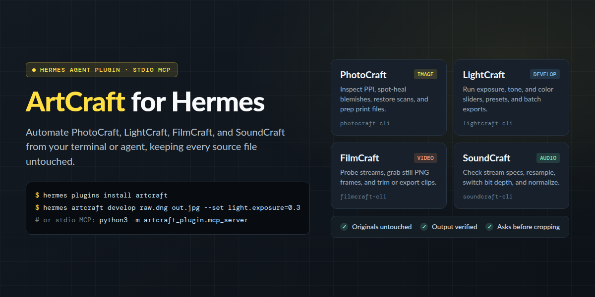
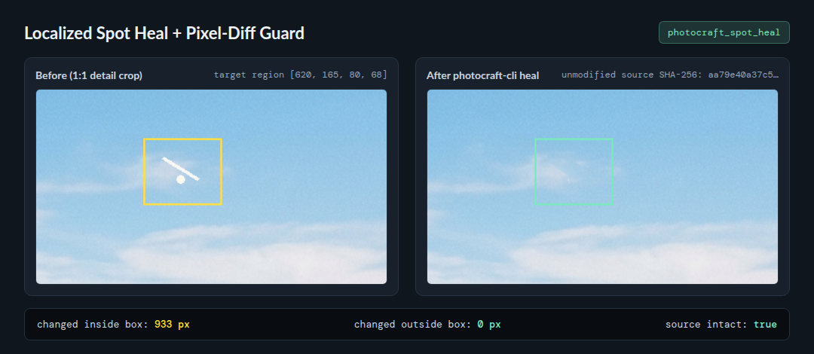
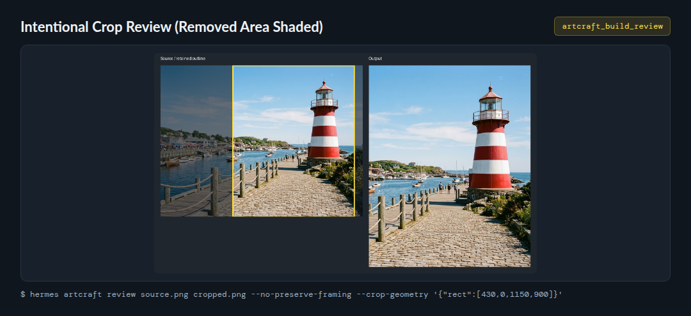
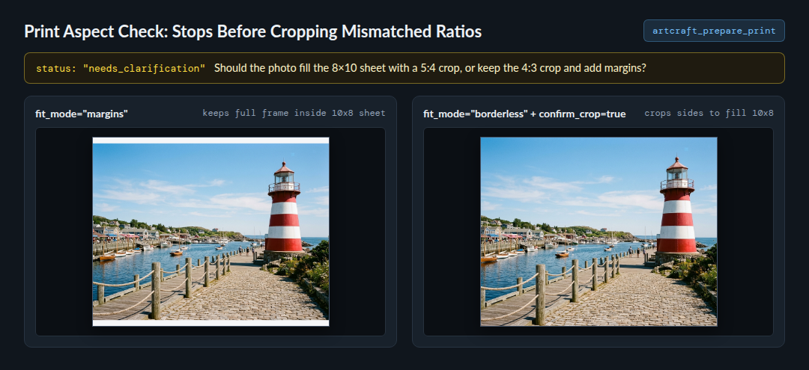
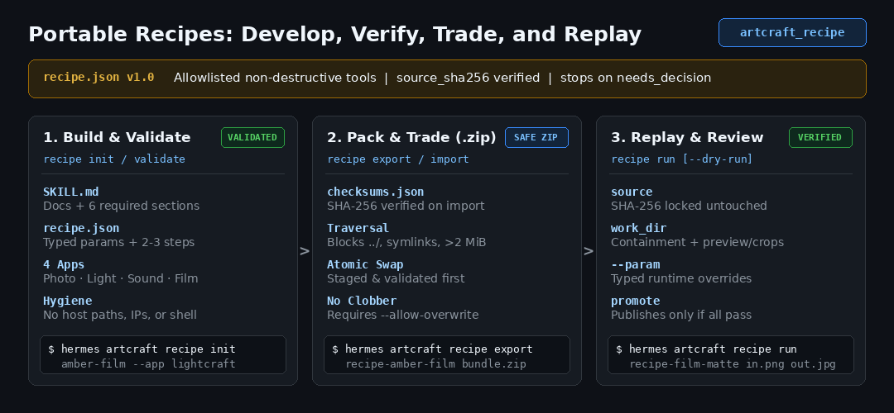

# hermes-artcraft-plugin



Run PhotoCraft, LightCraft, FilmCraft, and SoundCraft from [Hermes Agent](https://github.com/NousResearch/hermes-agent) or your terminal without touching original files. Every edit writes to a new path, hashes the source before and after, verifies output pixels or media streams, pauses before cropping mismatched prints or making risky restorations, and lets users develop and trade reusable workflow recipes (`recipe-maker` / `skills/recipe-*`).

```bash
hermes artcraft doctor
hermes artcraft develop photo.png photo_graded.jpg --set light.exposure=0.35 --size 2048
hermes artcraft prep-print photo_graded.jpg print_8x10.png --width 8 --height 10 --fit-mode margins
hermes artcraft recipe run recipe-film-matte photo.png photo_matte.jpg
```

## Installation

Install from the Hermes plugin catalog:

```bash
hermes plugins install artcraft
```

Or clone directly into your Hermes plugins directory:

```bash
git clone https://github.com/wspotter/hermes-artcraft-plugin.git ~/.hermes/plugins/artcraft
```

For local CLI usage or development, install in editable mode:

```bash
git clone https://github.com/wspotter/hermes-artcraft-plugin.git
cd hermes-artcraft-plugin
pip install -e ".[dev]"
```

Enable `artcraft` in your Hermes `config.yaml` (`plugins.enabled: [artcraft]`) and ensure `Pillow` is available in Hermes's Python environment.

The plugin looks for `photocraft-cli`, `lightcraft-cli`, `filmcraft-cli`, and `soundcraft-cli` in `ARTCRAFT_BIN_DIR`, `$HERMES_HOME/bin`, `~/.hermes/profiles/<profile>/bin`, `~/.hermes/bin`, `~/.local/bin`, `~/bin`, `~/.local/share/ArtCraft/bin`, `/usr/local/bin`, and `PATH`. Set `ARTCRAFT_BIN_DIR` if your binaries live elsewhere.

## Standalone MCP Server

Any MCP-compatible client can run the stdio server directly with no extra dependencies beyond `Pillow`:

```bash
python3 -m artcraft_plugin.mcp_server
```

Example MCP client entry:

```json
{
  "mcpServers": {
    "artcraft": {
      "command": "python3",
      "args": ["-m", "artcraft_plugin.mcp_server"]
    }
  }
}
```

## Running in a Bot VM, Sandbox, or Remote Machine

The `artcraft` plugin runs in the Hermes gateway environment and expects ArtCraft CLIs and target files to be accessible there.

- **Sandboxed bots and Bot Screens:** If a bot's shell or Hermes Bot Screen runs inside a separate container or VM sandbox, any file created only inside the sandbox must be staged or mounted onto a shared path before the plugin can read it and return the edit.
- **No ArtCraft installed in the VM:** Even without `*-cli` binaries present, the Pillow-backed tools still run (`artcraft_status`, `artcraft_inspect`, `artcraft_prepare_inspection`, `artcraft_prepare_print`, `artcraft_verify_edit`, `artcraft_checkpoint`, `artcraft_build_review`, `artcraft_job`, `artcraft_recipe` for inspect/validate/export/import and dry-run planning). `artcraft_restore_step` requires `photocraft-cli` alongside `photocraft_spot_heal`. On a Linux VM or container, you can also extract just the headless CLI binaries from an ArtCraft AppImage (`--appimage-extract "usr/bin/*-cli"`) without installing a desktop environment.
- **Using ArtCraft on another machine over SSH:** A stdio MCP server runs as a separate subprocess. When you wrap its launch command with `ssh`, `artcraft_plugin.mcp_server` runs on that remote ArtCraft machine instead of inside the bot's host, with source and output files staged or mounted on a path that machine can reach:

```json
{
  "mcpServers": {
    "artcraft": {
      "command": "ssh",
      "args": ["-T", "user@artcraft-host", "python3", "-m", "artcraft_plugin.mcp_server"]
    }
  }
}
```

Run `artcraft_status` at any time to see which CLI binaries are found and which tools are runnable in the current setup.

## How It Works in Practice

### Localized spot healing with pixel-diff verification

Ask Hermes:

> "Inspect `scan.png`, remove the dust scratch near `(180, 240)` to `(182, 290)`, and make sure nothing outside the repair box changes."



`photocraft_spot_heal` stages a copy of the source, confirms `changed_pixels > 0` inside `region`, and refuses to publish the output if `outside_pixels != 0`.

### Intentional crop review

When a crop is intentional, pass the kept boundary to `review` (`--no-preserve-framing --crop-geometry ...`) or `artcraft_build_review` (`crop_geometry`). It shades the removed area on the source preview and places the output beside it so you can review removed borders, corners, and composition. Coordinates are source pixels from the upper-left (`rect` `[left, top, right, bottom]` or a 4-point `quad` for perspective crops), with optional `artwork_rect` and `pixels_per_inch` keys on a rectangle if calibrated trim measurements are desired.

```bash
hermes artcraft review source.jpg cropped.jpg --no-preserve-framing \
  --crop-geometry '{"rect":[55,106,1745,2409]}'
```



### Print sizing without surprise crops

Ask Hermes:

> "Size `portrait.png` for an 8x10 print at 300 PPI."

Or run from the terminal:

```bash
hermes artcraft prep-print portrait.png print_8x10.png --width 8 --height 10 --fit-mode margins
```



If the photo and sheet aspect ratios differ and cropping was not explicitly confirmed (`--confirm-crop` or `--fit-mode margins`), `artcraft_prepare_print` stops before writing anything and asks whether to crop borderless or add margins.

### Portable, tradeable multi-step recipes

Turn multi-step edits across **PhotoCraft**, **LightCraft**, **SoundCraft**, and **FilmCraft** into portable `recipe-*` skills (`SKILL.md` + executable `recipe.json` manifest) that can be developed, validated, shared as checksummed `.zip` bundles, and replayed deterministically:

> "Create a reusable LightCraft matte look recipe, validate it, run it on `photo.png` without altering the original, and pack a `.zip` bundle I can trade."

```bash
hermes artcraft recipe init amber-film --app lightcraft
hermes artcraft recipe validate recipe-amber-film
hermes artcraft recipe run recipe-film-matte photo.png photo_matte.jpg --param contrast=15 --param shadows=20
hermes artcraft recipe export recipe-amber-film recipe-amber-film.zip
hermes artcraft recipe import recipe-amber-film.zip
```



`artcraft_recipe` ships with **9 runnable bundled recipes** (`recipe-faded-tones`, `recipe-color-cast`, `recipe-dust-scratches`, `recipe-noise-grain`, `recipe-sharpening`, `recipe-enlargement`, `recipe-film-matte`, `recipe-voice-master`, and `recipe-web-clip`). Replay stages outputs inside `{work_dir}`, restricts steps to allowlisted non-destructive tools, verifies pre/post `source_sha256`, pauses if a step hits `needs_decision` or `needs_clarification`, and blocks leaked local paths, private IPs, symlinks, or zip-slip entries when sharing.

## Safeguards

- Source files are never edited in place. Write tools require a new `output_path`, compare source SHA-256 digests before and after execution, and decode or probe the output before succeeding.
- Restoration steps (`artcraft_restore_step`) save checkpoints and 1:1 native plus print-scale before/after crops, and return `status: "needs_decision"` if asked to reconstruct missing faces/lettering or push parameters past safe limits.
- Review packages (`artcraft_build_review`) flag silent no-ops (`0` changed pixels), unexpected framing shifts, and smeared patches where local texture variance collapses.
- Job workspaces (`artcraft_job`) organize stages into `source/`, `work/`, `previews/`, `exports/`, and `job.json`, block duplicate deliveries of the same file hash to the same destination, and require uncertain deliveries to be checked before retrying.

## Tools

The plugin registers **16 Hermes tools** (`toolset: artcraft`) and exposes **14 high-level tools** over the stdio MCP server:

| Tool | Hermes | MCP | App / Scope | Purpose |
|---|---|---|---|---|
| `artcraft_status` | Yes | Yes | All 4 apps | Report installed ArtCraft CLIs, Pillow status, and runnable tools |
| `artcraft_inspect` | Yes | Yes | Photo / Raster | Read format, color mode, dimensions, DPI, orientation, and SHA-256 |
| `artcraft_prepare_inspection` | Yes | Yes | Photo / Raster | Create whole-photo preview, 1:1 crops, print PPI, and tonal/noise stats |
| `photocraft_spot_heal` | Yes | Yes | PhotoCraft | Heal inside `[x, y, w, h]` and fail if pixels outside change |
| `artcraft_develop` | Yes | Yes | LightCraft | Apply sliders, presets, and sizing into a verified new export |
| `artcraft_audio_basic` | Yes | Yes | SoundCraft | Probe audio streams (`info`) or convert, resample, normalize, and dither |
| `artcraft_video_basic` | Yes | Yes | FilmCraft | Probe media (`probe`), extract PNG frames (`render_frame`), or export clips |
| `artcraft_recipe` | Yes | Yes | All 4 / PIL | List, scaffold, validate, export/import zip bundles, and replay `recipe-*` workflows |
| `artcraft_prepare_print` | Yes | Yes | PhotoCraft / PIL | Size print files at target PPI, keeping ICC profiles and asking before cropping |
| `artcraft_restore_step` | Yes | Yes | PhotoCraft | Run one checkpointed restoration recipe with dual-scale crops and safety stops |
| `artcraft_checkpoint` | Yes | Yes | PhotoCraft | List or fetch restoration checkpoints and comparison crops |
| `artcraft_build_review` | Yes | Yes | Review / QA | Build before/after previews, crops, hashes, and no-op/crop/blur checks |
| `artcraft_job` | Yes | Yes | Workflow | Initialize job folders, save checkpoints, log exports, and track deliveries |
| `artcraft_verify_edit` | Yes | Yes | Verification | Verify output readability, dimensions, and pixel diff (full or region) |
| `photocraft_run` | Yes | No | PhotoCraft | Show `photocraft-cli` `--help` or `--version` |
| `lightcraft_run` | Yes | No | LightCraft | Show `lightcraft-cli` `--help` or `--version` |

## CLI Subcommands

Under Hermes:

```bash
hermes artcraft doctor
hermes artcraft inspect <path> [--working-dir DIR] [--preview-max DIM] [--crop-size SIZE]
hermes artcraft develop <input_path> <output_path> [--set KEY=VALUE ...] [--preset ID] [--size PX] [--quality 1..100]
hermes artcraft audio info <input_path>
hermes artcraft audio convert <input_path> <output_path> [--rate HZ] [--bit-depth 16|24|32f] [--normalize] [--dither|--no-dither]
hermes artcraft video probe --input <input_path>
hermes artcraft video render_frame --input <input_path> -o <output_path> [--seconds SEC] [--scale SCALE]
hermes artcraft video export --input <input_path> -o <output_path> [--start SEC] [--end SEC] [--format FMT] [--preset ID] [--scale SCALE]
hermes artcraft prep-print <input_path> <output_path> --width W --height H [--ppi PPI] [--fit-mode MODE] [--confirm-crop]
hermes artcraft restore <recipe> <input_path> <output_path> [--params JSON] [--region X Y W H] [--checkpoint-dir DIR]
hermes artcraft checkpoint {list,get} <checkpoint_dir> [--step-id ID]
hermes artcraft review <source_path> <output_path> [--working-dir DIR] [--region X Y W H] [--no-preserve-framing] [--crop-geometry JSON]
hermes artcraft job {init,checkpoint,resume,export,deliver,reconcile,status} <job_id> ...
hermes artcraft verify <input_path> <output_path> [--width W] [--height H] [--region X Y W H]
hermes artcraft recipe list [--skills-dir DIR]
hermes artcraft recipe init <slug> [--app {photocraft,lightcraft,soundcraft,filmcraft}] [--dest-dir DIR]
hermes artcraft recipe validate <recipe> [--skills-dir DIR]
hermes artcraft recipe export <recipe> <archive_path> [--skills-dir DIR]
hermes artcraft recipe import <archive_path> [--dest-dir DIR]
hermes artcraft recipe run <recipe> <input_path> <output_path> [--param KEY=VALUE ...] [--dry-run]
```

Standalone without Hermes:

```bash
python3 -m artcraft_plugin.cli doctor
python3 -m artcraft_plugin.cli inspect input.png --preview-max 1024 --crop-size 256
python3 -m artcraft_plugin.cli develop input.png developed.jpg --set light.exposure=0.3 --size 2048 --quality 92
python3 -m artcraft_plugin.cli audio info dialogue.wav
python3 -m artcraft_plugin.cli audio convert dialogue.wav dialogue_48k.wav --rate 48000 --bit-depth 24 --normalize
python3 -m artcraft_plugin.cli video probe --input clip.mp4
python3 -m artcraft_plugin.cli video render_frame --input clip.mp4 -o frame.png --seconds 1.5
python3 -m artcraft_plugin.cli video export --input clip.mp4 -o trim.mp4 --start 0.5 --end 4.0 --format mp4
python3 -m artcraft_plugin.cli prep-print input.png output.png --width 8 --height 10 --fit-mode margins
python3 -m artcraft_plugin.cli restore faded_tones input.png output.png --params '{"in_black": 15, "in_white": 240}'
python3 -m artcraft_plugin.cli checkpoint list ./checkpoints
python3 -m artcraft_plugin.cli job init my_job --workspace ./jobs --source input.png
python3 -m artcraft_plugin.cli verify input.png output.png --region 100 100 64 64
python3 -m artcraft_plugin.cli recipe list
python3 -m artcraft_plugin.cli recipe init amber-film --app lightcraft
python3 -m artcraft_plugin.cli recipe validate recipe-amber-film
python3 -m artcraft_plugin.cli recipe export recipe-amber-film recipe-amber-film.zip
python3 -m artcraft_plugin.cli recipe import recipe-amber-film.zip
python3 -m artcraft_plugin.cli recipe run recipe-film-matte input.png output.jpg
```

## Bundled Skills (`skills/`)

| Skill | Purpose |
|---|---|
| `artcraft-router` | Route creative media tasks across the ArtCraft CLI suite. |
| `lightcraft-basics` | Develop and render photos non-destructively. |
| `soundcraft-basics` | Inspect, convert, resample, and normalize audio files. |
| `filmcraft-basics` | Probe media, extract still frames, and export video clips. |
| `photo-inspection` | Generate whole-photo previews, native crops, and metrics. |
| `photo-restoration` | Run checkpointed photo repairs and review each step. |
| `print-preparation` | Format print-ready images with aspect and PPI checks. |
| `photocraft-cli-edits` | Apply localized spot healing with pixel-diff verification. |
| `lightcraft-cli-edits` | Inspect LightCraft CLI flags and verify exported images. |
| `recipe-maker` | Design, test, and save reusable ArtCraft workflow skills. |
| `recipe-faded-tones` | Restore compressed tonal range without clipping endpoints. |
| `recipe-color-cast` | Remove unwanted color tints while preserving skin tones. |
| `recipe-dust-scratches` | Heal isolated dust specks and scratches without blurring. |
| `recipe-noise-grain` | Reduce sensor and scan noise while retaining fine detail. |
| `recipe-sharpening` | Apply restrained unsharp masking without edge halos. |
| `recipe-enlargement` | Upscale images proportionally with restrained sharpening. |
| `recipe-film-matte` | Apply warm matte film contrast via LightCraft CLI (`recipe.json`). |
| `recipe-voice-master` | Clean and resample spoken-word audio to 48kHz WAV (`recipe.json`). |
| `recipe-web-clip` | Probe, preview-frame, and export web-ready video clips (`recipe.json`). |

## Development

Run the test suite with Python's standard library `unittest`:

```bash
python3 -m unittest discover -s tests -v
```

Or with dev dependencies (`pytest` and `ruff`):

```bash
pytest -v
ruff check .
```

## License

MIT
